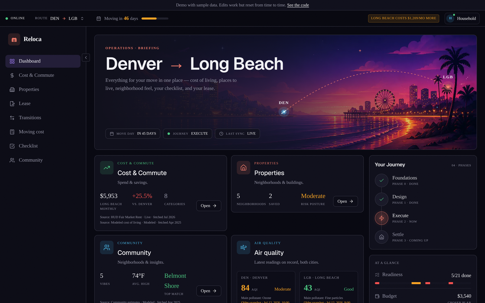
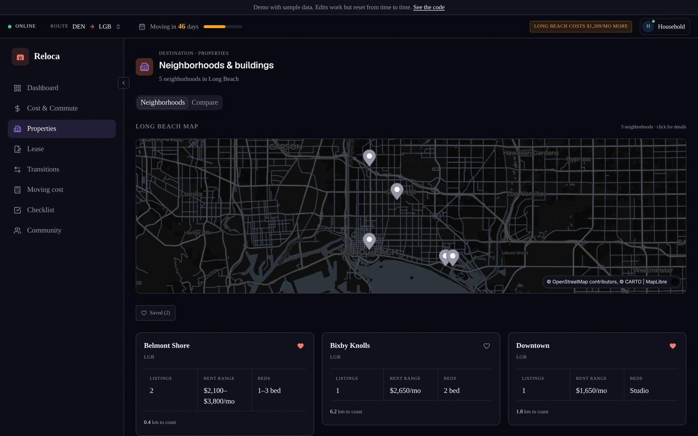

# Reloca

A relocation cockpit for one household moving between cities. I built it to run my own move from Denver: one dark dashboard that holds the checklist, the lease decision, the address changes, the moving budget, and a side-by-side look at the city I was leaving and the one I was heading to.

This repo is the public, portfolio version. Every name, address and dollar figure in it is sample data.

**[Try the live demo](https://reloca-demo.vercel.app)**. It runs on sample data in memory, with no sign-up, and your edits reset from time to time.



## What it does

- **Dashboard.** A countdown to move day, the next deadlines, and reference tiles that compare origin and destination on cost, climate and air quality. It switches to post-move states once the date passes.
- **Relocations.** Origin and destination are both swappable from a city pool (Denver, Long Beach, Sacramento). A switcher in the status row changes which pair you are looking at.
- **Checklist.** Moving tasks with due dates and drag-to-reorder.
- **Lease.** Pick stay, renew or vacate. A forecaster prices each path (renewal, leaving on time, one or two months month-to-month), a composer drafts the notice to vacate, and an insurance panel tracks coverage across both homes so there is no gap. A move-out walkthrough exports a PDF report.
- **Address changes.** Bank, employer, DMV, voter registration, insurance and subscriptions, each with its own deadline.
- **Moving cost and cost of living.** Budget for the move itself, plus a category-by-category comparison of the two cities.
- **Properties.** Neighborhoods and sample listings on a map, with a dialog that reads the details a building's own website publishes about itself (schema.org and Open Graph data, and only where the site's robots.txt allows) and fills them in.

  

## Data and where it comes from

Every reference number in the UI is labeled with how it was made, because some of it is live and some of it is my estimate:

| Tier | Sources |
| --- | --- |
| Live | HUD Fair Market Rent, NOAA climate normals, EPA AirNow, EPA National Walkability Index |
| Modeled | Cost of living, crime and climate hazards, built from public data and labeled as estimates |
| Sample | Listings and community notes |

`scripts/ingest-city.ts` refreshes the live tiers from the free APIs and writes JSON snapshots into `data/`.

## Stack

Next.js 15 (App Router, Turbopack), TypeScript, Tailwind CSS with shadcn/ui, Supabase (Postgres with row level security), Zod for every data shape, MapLibre with CARTO tiles, Recharts, React PDF. Hosted on Vercel.

## How I built it

I built Reloca with Claude Code as my coding partner. The project ran on a written rules file for the agent and moved in phases: brainstorm, blueprint, schema approval, then build in small waves, each one gated on tests and a clean production build. `docs/schema.md` documents the data model. Code comments that cite `AD-0NN` point to the private decision log, which is not part of this repo.

The hero image in `public/` was generated with an AI image model, and its file carries content credentials that say so.

## Run it locally

The quickest way in needs no database. Demo mode runs on fictional sample data held in memory:

```bash
pnpm install
RELOCA_MODE=demo pnpm dev
```

To run it on your own data you need Node 20+, pnpm, and a free Supabase project.

1. `pnpm install`
2. Copy `.env.template` to `.env.local`. Set `RELOCA_MODE=private`, fill in your Supabase URL and service role key, and set `RELOCA_ACCESS_GATE` (`local-only` fits a copy that stays on your computer; see Modes and deploying below). The API keys for HUD, NOAA, Census and AirNow are only needed if you run the ingest script.
3. Pick a UUID for `RELOCA_SINGLE_USER_ID`. Build the tables with the Supabase CLI: `supabase link`, then `supabase db push`. That applies every file in `supabase/migrations/` in order, exactly as written, and records which ones ran. No file needs editing. The database starts empty: add your move from the app, which also adds the starter checklist. `docs/database.md` covers the details, including how to bring a database that was set up by hand under the CLI.
4. `pnpm dev`

Tests are plain TypeScript scripts. `pnpm test` runs them all from the repo root, once in UTC and once in Pacific time, and stops at the first failure. To run one: `npx tsx --conditions=react-server path/to/file.test.ts`. After changing a migration, `pnpm db:check` builds the schema in a throwaway database on a local PostgreSQL server and checks it against the code.

## Modes and deploying

Reloca has two modes and no default. `RELOCA_MODE` has to say which one, and the app will not build or serve until it does. A missing or mistyped value stops it with an error in the server log. It never falls back to the database.

- `RELOCA_MODE=demo` runs on sample data held in memory and needs nothing else. The public demo runs this way. The older `RELOCA_DEMO_MODE=1` still works.
Both modes read `NEXT_PUBLIC_RELOCA_TIME_ZONE`, the household's time zone (for example `America/Los_Angeles`; the default is `America/Denver`). Countdowns, overdue flags and the date a notice is recorded as sent use the calendar day in that zone, so the server and the browser agree in the evening, when UTC is already on the next day.

- `RELOCA_MODE=private` runs on your own Supabase database. It needs the three Supabase values in `.env.template` (`SUPABASE_URL`, `SUPABASE_SERVICE_ROLE_KEY`, `RELOCA_SINGLE_USER_ID`) and `RELOCA_ACCESS_GATE`.

`RELOCA_ACCESS_GATE` exists because the app has no sign-in. In private mode, anyone who can open the site can read and change everything in it, so something outside the app has to keep strangers out. Set the variable to the name of that gate: for example `vercel-authentication` when Vercel's Deployment Protection covers every address of the project, the production domain included, or `local-only` for a copy that never leaves your computer. The app cannot check the gate for you. Naming it is a deliberate step, so a private copy cannot go live by accident with nothing in front of it.

On Vercel, add these as environment variables for every environment the project deploys (Production and Preview), then redeploy. The build reads them too, so a project without them fails at build time and keeps serving its previous deployment.

## Limits

Reloca is built for a single household, and it has no sign-in. The public demo runs in demo mode, so it has no database at all.

In private mode only the server talks to the database:

- The server uses the Supabase service role key. That key is a secret. It reads and writes everything, so it stays in server settings and never gets a `NEXT_PUBLIC_` name.
- The anon key is not used. After migration 0025 the database refuses it on every table, so a copy of it opens nothing.
- `RELOCA_SINGLE_USER_ID` is the id stored on every row. The server adds it to every query. It is an identifier, not a secret.

What this does not give you is a login. Anyone who can open a private deployment can read and change its data through the app, so keep it behind something like Vercel's login wall. Private mode will not run until `RELOCA_ACCESS_GATE` names what keeps it private. `docs/security-lockdown.md` has the rollout order for an existing database, the checks to run and how to undo it.

## License

Copyright (C) 2026 The Mambí. This program is free software: you can redistribute it and/or modify it under the terms of the GNU Affero General Public License as published by the Free Software Foundation, either version 3 of the License, or (at your option) any later version. See `LICENSE` for the full text.

Made by The Mambí · [themambi.com](https://themambi.com)
